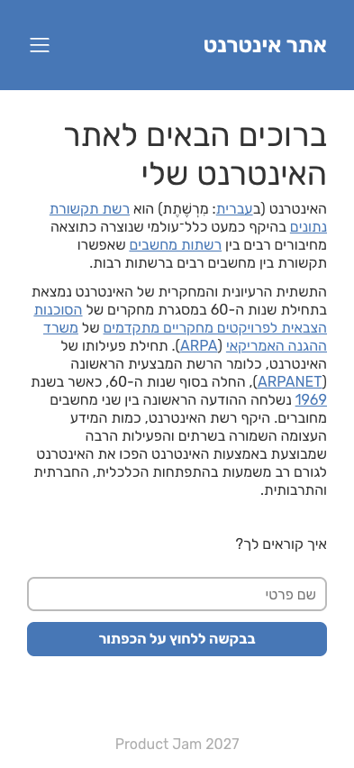

# Answers

Answer the questions below in this file, under each question. Put screenshots in
a `screenshots/` folder and link them from your answers.

## 1. Challenges and dilemmas

List at list 2 challenges or dilemmas that you faced while building the design in Part 1,
and how you decided to solve them?

**Answer:**

1. **A right-to-left page.** The design is in Hebrew, so the title is on the
   right and the menu on the left. I could have placed them with `float` or
   `flex-direction: row-reverse`, but I chose to set `lang="he" dir="rtl"` on
   `<html>` instead. That tells the browser the whole document is RTL, so
   flexbox, text alignment and the `margin-inline` / `padding-inline` logical
   properties all flip automatically, and screen readers read the text as
   Hebrew. The header is just `display: flex; justify-content: space-between`,
   and the first item (the title) lands on the right by itself.

2. **One menu for desktop and mobile.** On desktop the links sit in the
   header, and on mobile they are a full-screen overlay. I didn't want to write
   the links twice in the HTML, so there is a single `<nav>`, and a media query
   (`max-width: 700px`) turns it into a `position: fixed` overlay. The close
   button lives inside the `<nav>`, so it appears together with the menu.

3. **Animating the menu open and closed.** `display: none` can't be animated
   with a CSS transition, because the element disappears instantly. Instead,
   the closed menu has `opacity: 0`, `visibility: hidden` and is moved up a
   little with `transform`. JavaScript only adds or removes an `is-open` class,
   and CSS transitions those three properties. `visibility: hidden` (rather
   than just `opacity: 0`) matters: it stops the invisible menu from covering
   the page and catching clicks, and keeps its links out of the keyboard tab
   order. I also turn off the animation for people who chose
   `prefers-reduced-motion`.

4. **Buttons and forms instead of bare elements.** The menu icons could have
   been `` tags with click handlers, but I wrapped them in `<button>`
   elements with an `aria-label`, so they work with the keyboard and screen
   readers. For the same reason, the name field is a real `<form>` with a
   `<label>`, and I listen to the form's `submit` event (with
   `preventDefault()`, so the page doesn't reload). That way pressing Enter in
   the field says hello too, not only clicking the button.

## 2. Box model

Build the `.hello-world` example from the lesson 1 "CSS Box Model" slides, exactly as it appears
there, on a new page of your website. This page is only for answering questions
2 and 4, so it can be a temporary file, and you don't need to submit it.

Inspect the element with your browser's devtools.
Enable and disable `box-sizing: border-box;` and inspect the size of the element.
What is the total width, and why? Explain in detail.

**Answer:**

The CSS from the slides:

```css
.hello-world {
  box-sizing: border-box;
  width: 100px;
  margin: 10px;
  padding: 5px;
  border: 2px blue;
}
```


What devtools shows (width of the element's box, from border edge to border
edge; the margin is outside it):

| Case                                                        | Total width |
| ----------------------------------------------------------- | ----------- |
| `box-sizing: border-box` (as written)                       | **100px**   |
| `box-sizing: content-box`                                   | **110px**   |
| `content-box`, if the border had a style (`2px solid blue`) | 114px       |
| `border-box`, if the border had a style                     | 100px       |

**Why:**

- **The border is 0px, not 2px.** `border: 2px blue` sets a width and a color,
  but no **style**. The default `border-style` is `none`, and a border with
  style `none` has a computed width of `0`. In devtools the border layer of the
  box model diagram shows `-`, and nothing blue is drawn. So the slide's
  answer of 114px only happens if you add a style like `solid`.
- **With `box-sizing: content-box`** (the browser's default), `width: 100px`
  is the width of the _content_ only. Padding and border are added outside it:
  `5 + 100 + 5 = 110px` (plus `2 + 2 = 114px` if the border were visible).
- **With `box-sizing: border-box`**, `width: 100px` is the width of the
  _whole box_, including padding and border. The browser shrinks the content
  to fit: `100 - 5 - 5 = 90px` of content (or `86px` with a visible border),
  and the total stays **100px**.
- **The margin is never part of the width.** The 10px margin is space
  _outside_ the border on each side, so the element takes up
  `10 + 100 + 10 = 120px` of horizontal space in the layout (`130px` with
  `content-box`), but the element itself is still 100px (or 110px) wide.
- **A catch when toggling it in devtools:** unchecking `box-sizing:
border-box` on `.hello-world` changes nothing, because `styles/reset.css`
  already sets `*, *::before, *::after { box-sizing: border-box; }` for every
  element. To see the `content-box` width, you also have to uncheck the rule in
  `reset.css`, or add `box-sizing: content-box` to the element.

## 3. The viewport

Open the website on a mobile browser, or in the mobile view of Chrome's
devtools, then delete this line from the `<head>` of `index.html`:

```html
<meta name="viewport" content="width=device-width, initial-scale=1.0" />
```

What happens to your page? What does
this line tell the browser, and why does removing it affect your mobile design?

**Answer:**

| With the viewport tag                           | Without it                                            |
| ----------------------------------------------- | ----------------------------------------------------- |
|  |  |

**What happens:** on a phone 393px wide, the page shows the _desktop_ design,
zoomed out to fit the screen. The menu links are back in the header, the
hamburger icon is gone, and all the text is tiny and hard to read or tap. In
devtools, `document.documentElement.clientWidth` changes from `393` to `980`.

**What the line tells the browser:**

- `width=device-width` - make the layout viewport (the width the page is laid
  out in, which CSS `px` and media queries measure) the same as the device's
  screen width in CSS pixels, here 393px.
- `initial-scale=1.0` - start at 100% zoom, so 1 CSS pixel is shown at its
  normal size, without zooming in or out.

**Why removing it breaks the mobile design:** when phones first appeared,
almost every site was built for desktop. So, when a page doesn't have this tag,
mobile browsers assume it's an old desktop-only site: they lay it out in a
virtual viewport about 980px wide, and then shrink the result to fit the
screen. As far as the CSS is concerned, the screen is now 980px wide, so my
`@media (max-width: 700px)` rule never matches, and none of the mobile styles
(the menu icon, the full-screen menu, the full-width form) are applied. The
viewport tag is how a page says "I'm responsive, give me the real screen
width".
